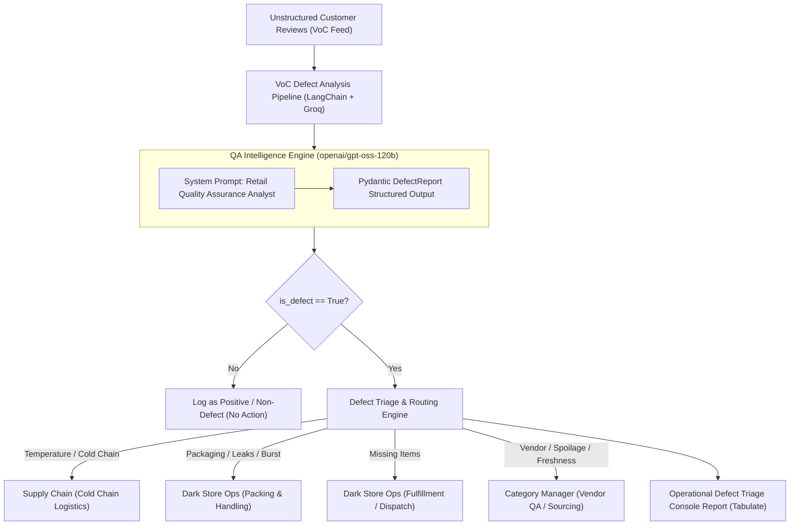

# Voice-of-Customer (VoC) Defect Routing Agent for Quick-Commerce Retail

An automated quality assurance and operational triage agent built using **Python**, **LangChain**, and **Groq's OpenAI-compatible endpoint** running `openai/gpt-oss-120b`.

The agent ingests unstructured quick-commerce customer reviews, analyzes them with retail QA analyst instructions, extracts structured Pydantic defect assessments, gauges incident severity, and autonomously routes actionable tickets to the appropriate operational departments (*Dark Store Ops*, *Category Managers*, or *Cold Chain / Supply Chain*).

---

## 🏛️ System Architecture



---

## 📋 Defect Triage & Routing Matrix

| Defect Type | Primary Triggers | Severity Range | Routing Destination | Operational Action |
| :--- | :--- | :---: | :--- | :--- |
| **Temperature** | Warm poultry, melted ice cream/gel packs, broken cold chain | **4 – 5** | `Supply_Chain` | Audit reefer telemetry, mandate passive dry-ice packs. |
| **Packaging** | Burst milk pouches, leaking bags, crushed egg cartons | **3 – 4** | `Dark_Store_Ops` | Retrain dark store packing associates on bag stacking. |
| **Missing_Item** | Order shortfall, missing butter/eggs, picker omission | **3** | `Dark_Store_Ops` | Instant customer refund, audit dispatch scan-verify logs. |
| **Quality** | Stale/slimy fish, sour/puffed paneer, fermented batch | **5** | `Category_Manager` | Quarantine vendor batch, trigger upstream supplier audit. |
| **None** | Positive customer reviews, on-time delivery praise | **1** | `None` | Log as satisfaction benchmark; no escalation required. |

---

## 📂 Project Structure

```
VOC-Defect-Routing-Agent/
├── requirements.txt      # langchain, langchain-openai, pydantic>=2.0.0, pandas, tabulate
├── schema.py             # DefectReport Pydantic model with strict Enums
├── data.py               # 10 synthetic quick-commerce reviews with ticket_id and store_id
├── agent.py              # ChatOpenAI (Groq openai/gpt-oss-120b) + with_structured_output
├── main.py               # Orchestrator filtering defects and generating triage scorecard
└── README.md             # Documentation
```

---

## ⚡ Quickstart

### 1. Installation
Install project dependencies:
```bash
pip install -r requirements.txt
```

### 2. Configure Groq API Key (Optional)
To use live high-speed inference with `openai/gpt-oss-120b`, set your Groq API key:
```bash
export GROQ_API_KEY="your-groq-api-key"
# Windows PowerShell:
# $env:GROQ_API_KEY="your-groq-api-key"
```
*(Note: If no API key is provided, the system seamlessly runs in deterministic QA logic mode for local testing).*

### 3. Run the Triage Agent
```bash
python main.py
```

---

## 📊 Sample Output

```text
=======================================================================================================================================
                     OPERATIONAL DEFECT TRIAGE & INCIDENT ROUTING SCORECARD                     
=======================================================================================================================================
+-------------+--------------------+------------------------------------------------------+-------------------------+---------------+------------+-----------------------+-------------------------------------------------+
| Ticket ID   | Dark Store         | Customer Review Snippet                              | Category                | Defect Type   | Severity   | Routing Destination   | Recommended Remediation                         |
+=============+====================+======================================================+=========================+===============+============+=======================+=================================================+
| TKT-801     | BLR-KORAMANGALA-04 | The skinless chicken curry cut was warm on arrival.. | Fresh Meat & Poultry    | Temperature   | 5/5        | Supply_Chain          | Audit cold-chain reefer logs and enforce insu.. |
+-------------+--------------------+------------------------------------------------------+-------------------------+---------------+------------+-----------------------+-------------------------------------------------+
| TKT-802     | MUM-ANDHERI-02     | Milk pouch was leaking all over the grocery bag! T.. | Dairy & Eggs            | Packaging     | 4/5        | Dark_Store_Ops        | Retrain dark store packing associates on heav.. |
+-------------+--------------------+------------------------------------------------------+-------------------------+---------------+------------+-----------------------+-------------------------------------------------+
| TKT-804     | DEL-SAKET-03       | Missing items in my Zepto delivery! I ordered 2 pa.. | Dairy & Eggs            | Missing_Item  | 3/5        | Dark_Store_Ops        | Issue immediate customer refund and retrain d.. |
+-------------+--------------------+------------------------------------------------------+-------------------------+---------------+------------+-----------------------+-------------------------------------------------+
| TKT-805     | HYD-HITECH-05      | Catla fish smelled off and the flesh was slimy whe.. | Seafood                 | Quality       | 5/5        | Category_Manager      | Escalate to Seafood Category Manager to quara.. |
+-------------+--------------------+------------------------------------------------------+-------------------------+---------------+------------+-----------------------+-------------------------------------------------+
| TKT-806     | BLR-WHITEFIELD-07  | Belgian chocolate tub was completely melted into l.. | Frozen Foods & Desserts | Temperature   | 4/5        | Supply_Chain          | Mandate passive cooling dry-ice pouches for a.. |
+-------------+--------------------+------------------------------------------------------+-------------------------+---------------+------------+-----------------------+-------------------------------------------------+
| TKT-808     | DEL-GURGAON-02     | Carton of 6 brown eggs arrived crushed and cracked.. | Dairy & Eggs            | Packaging     | 3/5        | Dark_Store_Ops        | Instruct dark store packers to place egg cart.. |
+-------------+--------------------+------------------------------------------------------+-------------------------+---------------+------------+-----------------------+-------------------------------------------------+
| TKT-810     | BLR-KORAMANGALA-04 | The paneer pack had air puffing and a sour, fermen.. | Dairy & Eggs            | Quality       | 5/5        | Category_Manager      | Quarantine dairy vendor batch across dark sto.. |
+-------------+--------------------+------------------------------------------------------+-------------------------+---------------+------------+-----------------------+-------------------------------------------------+

=================================================================
               OPERATIONAL TRIAGE SUMMARY METRICS                
=================================================================
+-------------------------------------------+------------------+
| Triage Metric                             | Summary Output   |
+===========================================+==================+
| Total Customer Reviews Ingested           | 10               |
+-------------------------------------------+------------------+
| Operational Defects Identified            | 7 (70.0%)        |
+-------------------------------------------+------------------+
| Average Defect Severity Rating            | 4.14 / 5.00      |
+-------------------------------------------+------------------+
| Routed to Dark Store Operations           | 3 tickets        |
+-------------------------------------------+------------------+
| Routed to Supply Chain (Cold Chain)       | 2 tickets        |
+-------------------------------------------+------------------+
| Routed to Category Management (Vendor QA) | 2 tickets        |
+-------------------------------------------+------------------+
=================================================================
```
